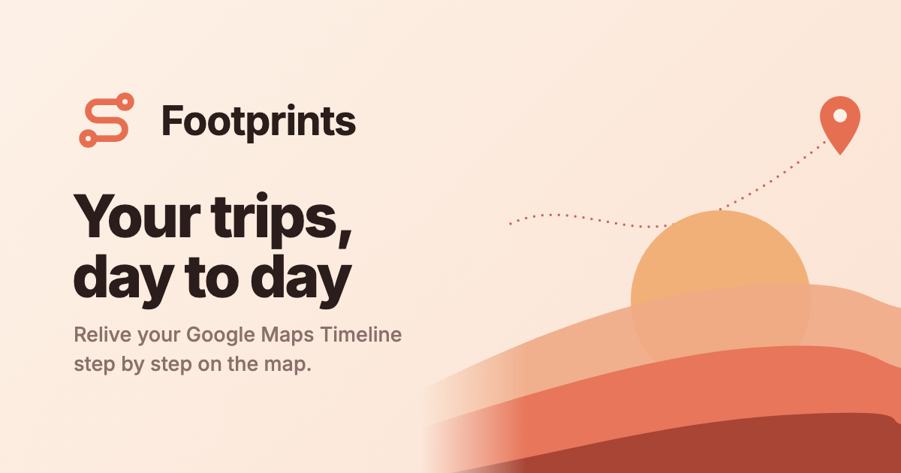

<div align="center">


# Footprints

**Relive your Google Maps Timeline, day by day, trip by trip.**

[](LICENSE)
[](package.json)
[](js/)
[](https://leafletjs.com)
[](https://www.openstreetmap.org)
[](#-privacy)
[](#-contributing)

[](https://github.com/cratag/footprints/stargazers)
[](https://github.com/cratag/footprints/network/members)



</div>

---

## 💭 Why I built this

Google Maps has been quietly logging every trip I've taken for years: the walks, the late-night bus rides, the long drives on vacation. When Timeline moved to the phone, I wanted a nicer way to **go back and relive those days**, watching each route draw itself on the map one step at a time.

So I built **Footprints** for myself. It's a small side project I made for fun, and I'm sharing it as open source in case it brings back good memories for someone else too. If you like it, a ⭐ makes my day.

## ✨ Features

- 🗺️ **Animated replay** of each day, trip by trip, with transport mode and destination
- 📅 **Calendar** to jump to any day in your history
- ✏️ **Edit** transport modes and place names, with edits saved locally and restorable
- 💾 **Export** your data plus edits to JSON and load it back later
- 🌍 **6 languages**: ES · EN · PT · FR · DE · IT (follows your browser language)
- 📴 **Offline maps**: cache and prefetch OpenStreetMap tiles for your routes
- 🔒 **Fully local**: your location history never leaves your computer
- 🪶 **Zero dependencies**: plain HTML, CSS and JS, with nothing to install

## 🚀 Quick start

```bash
git clone https://github.com/cratag/footprints.git
cd footprints
yarn dev        # or: npm run dev
```

It opens http://localhost:8000 (or the next free port). Optional env: `PORT=3000`, `NO_OPEN=1`.

> [!TIP]
> No export at hand? Click **"Try with sample data"** to take it for a spin.

### 1. Get your data

| Source            | File                                                                |
| ----------------- | ------------------------------------------------------------------- |
| 🤖 Android        | `Timeline.json` (exported from the Timeline settings on your phone) |
| 🍎 iPhone         | `location-history.json` (exported from Google Maps on your phone)   |
| 📦 Google Takeout | `.zip` or monthly JSON (_Semantic Location History_)                |

### 2. Replay it

1. Upload your file.
2. Pick a day in the calendar.
3. Press **Next** (or <kbd>→</kbd>) to draw each trip.

### ⌨️ Shortcuts

| Key                                                          | Action                      |
| ------------------------------------------------------------ | --------------------------- |
| <kbd>→</kbd> / <kbd>←</kbd>                                  | Next / previous step        |
| <kbd>↓</kbd> / <kbd>↑</kbd> (or <kbd>]</kbd> / <kbd>[</kbd>) | Next / previous day         |
| <kbd>Space</kbd>                                             | Play / pause                |
| <kbd>Home</kbd> / <kbd>End</kbd>                             | Restart day / show full day |

## ✏️ Edit & export

- Click ✎ on a step to change a trip's transport mode or destination, or a visit's place name. Edits can be restored.
- Edits are saved in the browser and reapplied if you upload the same file again.
- **Export** downloads `footprints-YYYY-MM-DD.json` with your data and edits, which you can upload again later.

## 📴 Offline map

While `yarn dev` is running, OpenStreetMap tiles are cached in `maps/tiles/`. To prefetch tiles for your routes:

```bash
yarn map:download ~/Downloads/Timeline.json            # zoom 10–16
yarn map:download Timeline.json --since 2026-10-01     # from a date
yarn map:download Timeline.json --dry                  # count tiles only
```

> [!NOTE]
> Max zoom is 16 per the [OSM tile policy](https://operations.osmfoundation.org/policies/tiles/). Unzip Takeout `.zip` files first.

## 🔒 Privacy

Your location history is personal, so Footprints is built to keep it with you:

- Files are processed **in your browser** and stored in local IndexedDB. There is no server and no account.
- Place names (if enabled) are looked up via [Nominatim](https://nominatim.org) using coordinates, cached in `localStorage`.
- Satellite thumbnails come from Esri World Imagery; map tiles from OpenStreetMap.

## 🗂️ Project structure

```
js/
├── app.js        # calendar, steps, map & animations (Leaflet)
├── parser.js     # normalizes export formats into visits and trips
├── i18n.js       # translations
├── geocode.js    # Nominatim lookups (1 req/s, cached)
├── store.js      # IndexedDB persistence
└── demo.js       # sample data
scripts/
├── dev.js            # dev server with tile cache
└── map-download.js   # yarn map:download
```

## 🤝 Contributing

Ideas, bug reports and PRs are very welcome! A few easy ways to help:

- 🐛 [Open an issue](https://github.com/cratag/footprints/issues) if an export doesn't parse correctly
- 🌐 Add or improve a translation in `js/i18n.js`
- 💡 Suggest a feature that would make reliving your trips nicer

## 📄 License

[MIT](LICENSE). Use it, fork it, make it yours.

<div align="center">

<sub>Vibecoded with ❤️ to relive old trips · If Footprints brought back a good memory, consider leaving a ⭐</sub>

</div>
